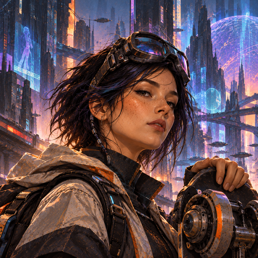

<p align="center">
  
</p>

[](https://nixos.org)
[](flake.lock)
[](#machines)
[](https://github.com/jrolfs/system/commits/main)

One Nix flake that configures every machine I own, macOS and Linux alike:
[nix-darwin](https://github.com/nix-darwin/nix-darwin) for the Macs,
[NixOS](https://nixos.org) for Linux, and
[home-manager](https://github.com/nix-community/home-manager) for the dotfiles
they share. It lives at `~/.config/system` on each machine.

## Getting started

A new machine is set up by [bootstrap](https://github.com/jrolfs/bootstrap),
which installs what the flake needs, clones this repository, signs in to
1Password for secrets, and runs the first switch. Every step is resumable, so
running it again picks up wherever it stopped.

### macOS

```sh
bash -c "$(curl -fsSL https://raw.githubusercontent.com/jrolfs/bootstrap/main/bootstrap.sh)"
```

It installs the Command Line Tools and [Lix](https://lix.systems), then Homebrew
for the apps that only ship as casks.

### NixOS

Boot the [NixOS installer](https://nixos.org/download/#nixos-iso) (`bootstrap
media write <iso>` makes the USB stick), set a password with `passwd` so you can
SSH in, then run:

```sh
nix --extra-experimental-features 'nix-command flakes' run github:jrolfs/bootstrap
```

On installer media it partitions the disk with
[disko](https://github.com/nix-community/disko) and installs the system. Reboot,
log in, and run the same command again for the rest.

## Day to day

```sh
nix-switch              # build and activate this machine
nix-switch --pull       # pull this repository first, from anywhere
nix-switch --update     # refresh flake.lock first (--update=nixpkgs for one input)
```

The reasoning behind each area lives in [`documentation/`](documentation).

## Machines

| | Name | Hardware | System |
|---|---|---|---|
|  | **Ala** | MacBook Air M4 | nix-darwin |
|  | **Adrian** | MacBook Air M5, work | nix-darwin, alongside MDM |
|  | **Irulan** | Beelink SEi 12 mini PC | NixOS: home server, and a desktop on the TV |
|  | **Leia** | QNAP NAS | QTS, not managed here |
|  | **Yours Truly** | MacBook Air M1, shared | not yet migrated |
|  | **Newt** | MacBook, work | retired |

**Leia** runs QNAP's own operating system, which has no place for Nix. Most of
its services are moving to Irulan, leaving it with the media and the download
stack that writes to it, deployed by [Komodo](https://komo.do)
([plan](documentation/IRULAN-MIGRATION.md)). Replacing QTS with NixOS would
bring it into this flake too, and is best done when its drives are next
replaced.

**Yours Truly** still runs the old setup this repository replaced. It has a
second user, so migrating it means Homebrew and system-wide settings have to
work for an account that isn't the one this flake is built around.
